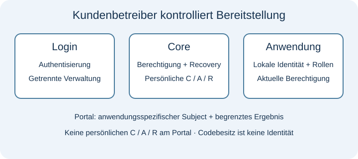

# PAS · Privacy Access System

[English](README.md) · [Architektur](handbook.de.md#architektur) · [Am Review teilnehmen](https://github.com/ripitship/pas-privacy-access-system/issues)

**Können Zugang und Wiederherstellung funktionieren, ohne E-Mail zur Pflichtgrundlage zu machen?** PAS untersucht einen besitzbasierten Berechtigungsnachweis mit einer nutzerfreundlichen Login-Schicht darüber und Wiederherstellungsregeln unter Kontrolle des jeweiligen Betreibers.

Persönliches Entwicklungsprojekt von Leo de Matos. **Prototyp, nicht produktionsreif.** Der PAS-Kerncode bleibt privat; dieses öffentliche Repository dient Architekturdiskussion und Dokumentationsfeedback, nicht als ausführbare PAS-Veröffentlichung.

## Warum untersuchen wir das?

Der Entwurf trennt drei Fragen: **Bist du berechtigt? Wie meldest du dich an? In welcher Identität und Rolle darfst du in dieser Anwendung handeln?** Nicht jeder Dienst braucht dafür eine E-Mail-Adresse. Manche benötigen trotzdem eine geprüfte geschäftliche Identität; diese Zuordnung und ihre Rollen muss die Anwendung ausdrücklich herstellen.

Der vorgesehene Betreiber kontrolliert Hosting, Schlüssel, Recovery-Regeln, Identitätszuordnung und Update-Freigabe. DE/EU-first ist ein Betriebsziel, keine Zertifizierung oder durch GitHub-Dokumentation bewiesene Unabhängigkeit. GitHub ist kein erforderlicher PAS-Identitätsdienst im Betrieb.

## Einstieg in fünf Minuten

- [Einen synthetischen Zugangs- und Recovery-Ablauf verfolgen](handbook.de.md#illustrativer-ablauf). Zum Lesen braucht es weder Installation noch PAS-Konto.
- [Vertrauensgrenzen und Integrationsvertrag ansehen](handbook.de.md#architektur).
- [Eine Review-Frage auswählen](REVIEW.md#drei-einstiegsfragen) und [mitdiskutieren](https://github.com/ripitship/pas-privacy-access-system/issues). Ein kurzer, konkreter Einwand hilft; niemand muss das ganze Projekt prüfen.

## So greifen die Ebenen ineinander

Login authentisiert den Zugang; Core verwaltet Berechtigungen und Recovery; eine Anwendung ordnet einen anwendungsspezifischen Subject ihrer eigenen Identität und ihren Rollen zu. Codebesitz identifiziert keine reale Person. Das Portal erhält keine persönlichen C/A/R-Nachweise. [Architektur ansehen](handbook.de.md#architektur).

## Evaluation im November

Für ein aktiviertes Konto mit geprüfter Empfängerbindung gibt ein separater Offline-Signer die konkrete Passkey-Registrierung frei. Die geführte Guardian-Einrichtung verlangt sowohl den Besitznachweis des Guardians als auch eine frische Nutzerverifikation mit dem Passkey des Kontoinhabers. Geht die Serverantwort verloren, prüft die Oberfläche die aktuelle Bindung. Kann sie die Bindung nicht bestätigen, zeigt sie das Ergebnis als unklar an.

Ein autorisierter Restore erhält die dauerhafte Recovery-Autorität. Er entwertet bestehende Sitzungen, ausstehende Recovery-Tickets und gespeicherte offene Autorisierungsanfragen und Ceremonies. Geeignete unterbrochene Recovery-Fälle lassen sich mit frischem Nachweis des ursprünglichen Zielschlüssels unter den ursprünglichen Quorum-, Warn- und Fristregeln fortsetzen. [Aktuelle Evaluationsabläufe](handbook.de.md#aktuelle-evaluationsabläufe).

## Hilf uns, den Entwurf kritisch zu prüfen

1. **Identitätsgrenze:** Wo benötigt deine Anwendung eine reale Identität statt eines Berechtigungsnachweises?
2. **Recovery:** Welche Verlustfälle sollten eine Wiederherstellung ausschließen, statt einen Reset zuzulassen?
3. **Integration:** Welche Protokolle, Rollenzuordnungen und Betriebsnachweise brauchst du vor einer begleiteten Evaluation?

[Bestehende Fragen diskutieren](https://github.com/ripitship/pas-privacy-access-system/issues) oder [eine eigene stellen](https://github.com/ripitship/pas-privacy-access-system/issues/new/choose). Bitte allgemeine oder synthetische Beispiele nutzen. Normale Fragen brauchen keine private Review-Vereinbarung. Sensible Befunde richten sich nach [SECURITY.md](SECURITY.md), niemals nach öffentlichen Kommentaren.

## Was ist belegt, und was noch nicht?

Software 0.8.0 · API v1 · Schema 6 · `production_ready=false`. In der internen Evaluation am 23. November 2026 bestanden 1.118 PAS-Tests bei 14 übersprungenen Fällen, 31 Node-Oberflächentests sowie 21/21 lokale Core-Prüfungen und 24/24 Prüfungen im Integrationslabor. Die Linux-Ergebnisse vom 6. Oktober beziehen sich auf die ältere Evaluation. Die GitHub-CI prüft diese Dokumentation. [Datierte Nachweise und Evaluationsgrenzen](evidence.de.md).

Gemeinsamer Diebstahl von Besitz- und Recovery-Nachweisen ist ein benanntes P0-Risiko. Totalverlust lässt sich ohne zulässigen unabhängigen Nachweis nicht sicher wiederherstellen. Höhere Recovery-Absicherung braucht tatsächliche Passkey-, Guardian-, Warnungs- und Schlüsselisolationsvorkehrungen; P2 bleibt gesperrt. Vollständige Anonymität, universelle Plattformkompatibilität oder Produktionsfreigabe werden nicht behauptet. [Recovery- und Betriebsgrenzen](handbook.de.md#recovery).

## Quellcode, Mitwirkung und mögliche spätere Zusammenarbeit

Der vollständige PAS-Quellcode bleibt privat. Dieses Repository enthält Dokumentation, synthetische Grafiken und einen eigenständigen Dokumentationsprüfer. Öffentliche Leser können den Entwurf kritisieren, aber die private PAS-Implementierung mit diesem Baum weder reproduzieren noch auditieren. Individuell freigegebene private Evaluationen brauchen gesonderten Umfang und vereinbarte Bedingungen. [Review-Ablauf](REVIEW.md) · [Mitwirkung](CONTRIBUTING.md).

Wenn das Problem in deinem Arbeitsumfeld relevant ist, beschreibe den allgemeinen Ablauf und was eine brauchbare Lösung belegen müsste. Spätere Zusammenarbeit kann gesondert betrachtet werden; dieses persönliche Projekt ist kein kommerzielles Angebot oder Supportdienst. Leo de Matos ist Projektinitiator und Kontakt über GitHub. Zuordnung und Nutzungsgrenzen erläutert der [Rechtehinweis](NOTICE.md).

Stand der Vorstellung: 24. November 2026. [FAQ und Entwicklungsroadmap](FAQ.de.md).
