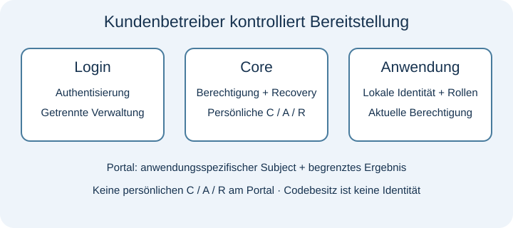

# PAS · Privacy Access System

[English](README.md) · [Technischer Leitfaden](handbook.de.md) · [Nachweise](evidence.de.md) · [FAQ und Roadmap](FAQ.de.md)

Dokumentation vorbereitet am 23.10.2026; privater Repository-Arbeitsstand aktualisiert am 26.10.2026. Software 0.8.0 · API v1 · Schema 6 · `production_ready=false`.

PAS untersucht Berechtigungen, Zugang und Recovery unter Betriebskontrolle des Kunden, ohne Pflicht-E-Mail oder obligatorisches Hersteller-Identitätskonto. IT-Beratungen, Dienstleister und Integratoren können prüfen, ob das Modell zu ihren Kundenabläufen passt. DE/EU-first ist ein Betriebsziel, das für jede tatsächliche Bereitstellung belegt werden muss.

Eine typische Evaluation folgt einem ausgegebenen Berechtigungsnachweis über Aktivierung, bequemen Login und eine geschützte Anwendungsaktion bis zu kontrollierter Recovery oder Widerruf. Gesucht ist Feedback zu diesem Integrationsablauf, Identitäts-/Rollengrenzen, Recovery-Risiken und betrieblicher Eignung. [Synthetischen Ablauf verfolgen](handbook.de.md#illustrativer-ablauf).

Login authentisiert den Zugang; Core verwaltet Berechtigungen und Recovery; eine Anwendung ordnet einen anwendungsspezifischen Subject ihrer eigenen Identität und ihren Rollen zu. Codebesitz identifiziert keine reale Person. Das Portal erhält keine persönlichen C/A/R-Nachweise. [Architektur und synthetischen Ablauf ansehen](handbook.de.md#architektur).

Dies ist das Dokumentations- und technische Review-Repository für PAS unter `ripitship/pas-privacy-access-system`. Es wird derzeit privat vorbereitet, während Veröffentlichung, Rechte und Kontaktpflichten geklärt werden. Nach öffentlichem Start und Einrichtung der Kanäle können normale, nicht vertrauliche Fragen, Feedback sowie Review- und Partneranfragen über Issues erfolgen. Vor dem Start muss ein vertraulicher Sicherheitsmeldeweg eingerichtet sein; ein bereits betriebsbereiter Kanal wird nicht behauptet. Review-Anfragen brauchen eine individuelle Freigabe und gewähren keinen Quellzugang.

Der vollständige PAS-Quellcode bleibt privat. Kostenlose technische Evaluation ist unter vereinbarten Review-Bedingungen vorgesehen; dauerhafte geschäftliche Nutzung erfordert eine Vereinbarung. Dies ist keine freie Open-Source-Veröffentlichung, ausführbare Demo oder Produktionszertifizierung. [Veröffentlichungs- und Rechtehinweis](NOTICE.md).

Leo de Matos ist Projektinitiator und vorgesehener Projektkontakt. Diese Zuordnung belegt keine alleinige Urheberschaft oder Rechteinhaberschaft an sämtlicher Software sowie fremden oder KI-unterstützten Materialien. Kontakt-SLA oder automatischer Support werden nicht zugesagt.

Einstieg: [Integration und Risiken](handbook.de.md#integration), [datierte interne Nachweise](evidence.de.md), dann [privates Review anfragen](REVIEW.md). Sensible Befunde richten sich nach [SECURITY.md](SECURITY.md).
