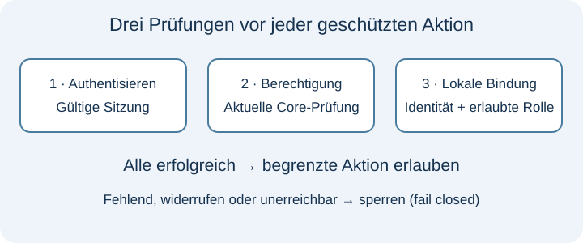
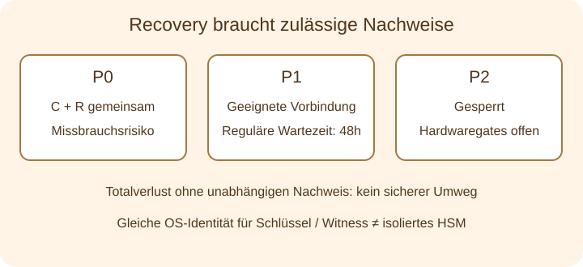

# Technischer Leitfaden

[Start](README.de.md) · [English](handbook.en.md)

## Architektur

Der Betreiber kontrolliert Hosting, Schlüssel, Rollen, fachliche Identitätszuordnung, Daten und Updatefreigabe. GitHub ist eine optionale Dokumentations-/Zusammenarbeitsplattform, niemals ein erforderlicher PAS-Identitätsdienst zur Laufzeit. Privater Code auf GitHub wäre eine separate Offenlegungs- und Hostingentscheidung und kein Nachweis von EU-Souveränität.

Persönliche C- (Besitz), A- (Zugang) und R- (Recovery) Nachweise gehören in die vorgesehenen PAS-Abläufe. Login-Verwaltung, Core und Portal/Anwendung behalten getrennte Aufgaben. Das Portal erhält anwendungsspezifische Subjects und begrenzte Ergebnisse, keine persönlichen C/A/R. Ein Subject ist keine bestätigte bürgerliche Identität. Die Anwendung muss selbst Identitätsbindung, fachliche Referenz und Rolle herstellen und vor geschützten fachlichen Aktionen die aktuelle Berechtigung prüfen.

## Integration

Integratoren müssen Empfängerschlüssel, registrierte Clients, Scopes, Replay-Abwehr und den genauen Callback-/Sitzungsvertrag anhand der privaten Integrationsspezifikation prüfen. Anonyme, gefälschte, wiederholte und clientübergreifende Anfragen sind abzuweisen. Erfolgreicher Login oder Callback allein autorisiert keinen Fachzugang. Explizite lokale Subject-Zuordnung und Rollenprüfung sind erforderlich. Widerruf, Bindungsentfernung, Core-Ausfall und Recovery sind mit der tatsächlichen Anwendung zu prüfen.

Die historische Beispiel-App ist ein separater Consumer ohne PAS-Servercode. Sie ist Integrationsreferenz, keine universelle SAP-, Pega-, IBM-, Salesforce- oder n8n-Kompatibilität. Adapter sind einzeln zu bewerten. Native Linux-App-Kindprozesse teilten den PAS-Interpreter; separate App20- und OCI-Nachweise decken andere Grenzen ab.

## Illustrativer Ablauf

Dies ist ein synthetischer Papierablauf, keine ausführbare Demonstration oder echte Kundengeschichte. Ein erfundener Betreiber verbindet ein internes Portal und eine Partneranwendung. Ein synthetischer Nutzer erhält getrennte anwendungsspezifische Subjects. Der Betreiber prüft die fachliche Identität und bindet den Partner-Subject an eine lokale Leserrolle. Login, aktuelle Berechtigung und diese Bindung erlauben Lesen; Bearbeiten bleibt gesperrt. Entfernen der Bindung sperrt die nächste geschützte Aktion. Widerruf oder unerreichbarer Core sperren ebenfalls. Recovery entwertet frühere Sitzungen und Nachweise; stabile Anwendungszuordnungen müssen korrekt gebunden bleiben. Private Reviewer sollen diese Entscheidungen ausschließlich mit synthetischem Zustand reproduzieren.

| Schritt | Was im Beispiel passiert | Kritisch zu prüfende Grenze |
|---|---|---|
| 1. Berechtigung | Der Betreiber gibt einen besitzbasierten Nachweis an einen synthetischen Teilnehmer aus. | Berechtigung ist kein Nachweis der bürgerlichen Identität. |
| 2. Aktivierung | Der Teilnehmer folgt der vorgesehenen PAS-Aktivierung und Login-Einrichtung, ohne Pflicht-E-Mail. | Persönliche Nachweise bleiben in PAS-Abläufen, nicht in Portal-Skripten. |
| 3. Anwendungszugang | Das Portal erhält einen anwendungsspezifischen Subject und prüft lokale Identitäts-/Rollenbindung sowie aktuelle Berechtigung. | Erfolgreiche Authentisierung allein gewährt keine fachliche Rolle. |
| 4. Begrenzte Aktion | Lesen ist für die synthetische Leserrolle erlaubt; Bearbeiten bleibt gesperrt. | Die Anwendung verantwortet ihre fachliche Autorisierung. |
| 5. Widerruf oder Ausfall | Entfernte Bindung, widerrufene Berechtigung oder unerreichbarer Core sperren die nächste geschützte Aktion. | Fail-closed schützt die Zugangsgrenze zulasten der Verfügbarkeit. |
| 6. Verlorene Zugangsdaten | Recovery folgt dem konfigurierten Profil und unabhängigen Nachweisanforderungen; bestehende Sitzungen/Nachweise werden entwertet. | Ein Code allein darf kein undokumentierter Universalreset werden. Totalverlust kann nicht wiederherstellbar bleiben. |

Diese Tabelle erklärt den vorgesehenen Referenzablauf, sie ist kein neues Ausführungsergebnis. [Eine Review-Frage auswählen](REVIEW.md#drei-einstiegsfragen).

## Recovery

P0 hat ein Risiko bei gemeinsamem C+R-Diebstahl: Der Besitz beider Nachweise kann Missbrauch ermöglichen. Totalverlust ohne zulässigen unabhängigen Nachweis ist nicht sicher wiederherstellbar. P1 erfordert zwei geeignete Passkeys, drei vorgebundene Guardian-Public-Keys und tatsächlich konfigurierte Zweckschlüsselprovider/Witness. Zwei von drei unterschiedlichen Guardians signieren denselben Antrag; die reguläre 48-Stunden-Frist beginnt beim Quorum. Drei Schlüssel allein beweisen nicht drei unabhängige Personen oder Geräte. Eine separat signierte Warnquittung und Veto-Behandlung sind nötig; der Betreiber muss erreichbare Warnkanäle vereinbaren und erproben. Lokale Outbox oder Guardian-Quittung allein beweisen keine rechtzeitige Warnzustellung an eine Person. Diese Veröffentlichung behauptet keinen neu gemessenen echten 48-Stunden-Hardwarelauf. P2 bleibt bis zu den erforderlichen Hardware-/Isolationsnachweisen gesperrt. Referenzschlüssel und Witness unter derselben OS-Identität bieten keine unabhängige HSM- oder Administratorisolation.

## Anwendungsfälle

Beratungen können kundeneigene Lizenz-/Berechtigungsabläufe, interne Portale und Partneranwendungen mit expliziter fachlicher Rollenbindung bewerten. Einstieg sind betreute Evaluation, synthetische Nutzer und begrenzte Integrationsziele. Referenzkunden, Wettbewerbsvorteil, proprietäre Neuheit oder vollständige Anonymität werden nicht behauptet. Der Betreiber verantwortet reale Identitäten, Zugangsentscheidungen und Recovery-Regeln.

## Verfügbarkeit und Betriebsgrenzen

Fail-closed-Prüfungen schützen Berechtigungsgrenzen und machen Core-Ausfälle zum fachlichen Verfügbarkeitsrisiko. Ausfallverhalten, Überwachung, Restore-Übungen und Supportverantwortung sind vor einem Kundendienst festzulegen. Backup-Aktualität, Rollback-Abweisung, Schlüssel-/Witness-Verwahrung und stabile Identitätszuordnungen nach Restore sind zu prüfen. HA, Produktions-TLS/DNS, reale Browser-/Authenticator-Nachweise, unabhängige Sicherheits-/SCA-Prüfung und Produktionsfreigabe bleiben offen.

Die privaten 0.8-Pakete enthalten Quellen, keinen universellen Offline-Installer oder fertiges Programm. Sie brauchen vertrauenswürdiges Python 3.12, exakte Abhängigkeiten und explizite private Initialisierung. Interaktiver Login/Consent/Passkeys benötigt geeignete Browser und Authenticatoren; Core kann ohne GUI laufen. Historische Plattformnachweise betreffen Darwin ARM64 und Linux ARM64; Windows, Linux x86_64 und andere Engines sind nicht belegt. [Nachweise und Reproduzierbarkeitsgrenzen](evidence.de.md).

## Review-Fragen

Kann Ihre Anwendung Authentisierung, aktuelle Berechtigung und lokale Rollenbindung unterscheiden? Wer kontrolliert jeden Schlüssel und Witness, und kann eine OS-Identität alle kompromittieren? Passt gemeinsamer C+R-Diebstahl zu Ihrem Bedrohungsmodell? Welche unabhängigen Recovery-Nachweise sind zulässig? Welchen Verfügbarkeitsverlust tolerieren Sie? Kann Restore alte Zustände abweisen und korrekte Anwendungsbindungen erhalten? Welche tatsächlichen Betriebs-, Datenschutz-, Rechts- und Organisationsnachweise brauchen Sie vor Produktion?
