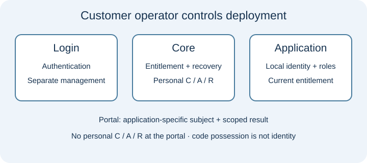
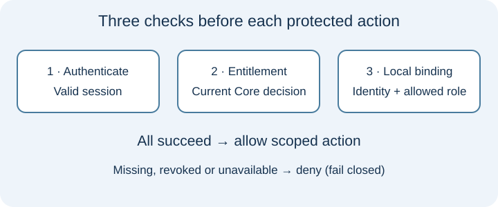
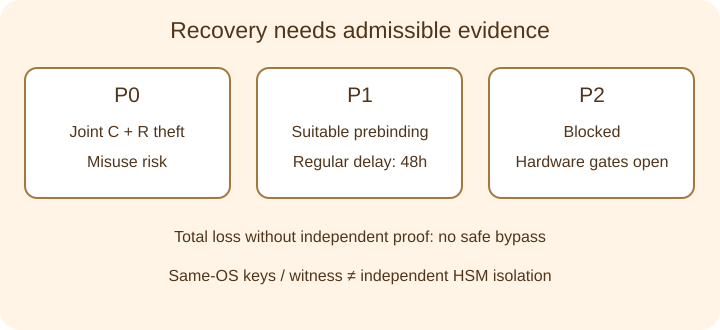

# Technical handbook

[Home](README.md) · [Deutsch](handbook.de.md)

## Architecture

The operator controls hosting, keys, roles, business identity mapping, data and update approval. GitHub is an optional documentation/collaboration venue, never a required PAS runtime identity service. Storing private code on GitHub would be a separate disclosure and hosting decision, not proof of EU sovereignty.

Personal C (possession), A (access) and R (recovery) proofs belong in the designated PAS flows. Login management, Core and portal/application responsibilities remain separate. The portal receives application-specific subjects and scoped results, not personal C/A/R. A subject is not a verified civil identity. The application must establish its own identity binding, business reference and role, then check current entitlement before allowing protected business actions.

## Integration

Integrators must verify recipient keys, registered clients, scopes, replay resistance and the exact callback/session contract with the private integration specification. Reject anonymous, forged, replayed and cross-client requests. A successful login or callback alone does not authorize business access. Explicit local subject binding and role checks are required. Revocation, binding removal, Core outage and recovery must be exercised with the actual consuming application.

The archival sample App is a separate consumer without PAS server code. It is an integration reference, not universal SAP, Pega, IBM, Salesforce or n8n compatibility. Evaluate adapters individually. The native Linux App subprocesses shared the PAS interpreter; a separate App20 environment and OCI evidence cover different boundaries.

## Illustrative walkthrough

This is a synthetic paper walkthrough, not an executable demonstration or real customer story. A fictitious operator connects an internal portal and a partner application. A synthetic user receives separate application-specific subjects. The operator checks the business identity and binds the partner subject to a local reader role. Login plus current entitlement plus that binding permits reading; editing stays denied. Removing the binding denies the next protected operation. Revocation or an unavailable Core also denies access. Recovery invalidates prior sessions and proofs while stable application mappings must remain correctly bound. Private reviewers should reproduce these decisions with synthetic state only.

## Recovery

P0 has a joint C+R theft risk: possession of both proofs can enable misuse. Total loss without an admissible independent proof cannot safely be recovered. P1 requires two suitable passkeys, three prebound guardian public keys and actually configured purpose-key providers/witness. Two of three distinct guardians sign the same request; the regular 48-hour delay starts at quorum. Three keys alone do not prove three independent people or devices. A separately signed warning receipt and veto handling are required; the operator must arrange and test reachable warning channels. A local outbox or guardian receipt alone does not prove timely warning delivery to a person. This publication does not claim a newly measured real 48-hour hardware run. P2 remains blocked pending the required hardware/isolation evidence. Reference keys and witness under the same OS identity do not provide independent HSM or administrator isolation.

## Use cases

Consultants can assess customer-operated licence/entitlement workflows, internal portals, and partner-facing applications with explicit business role binding. Start with a supervised evaluation, synthetic users and bounded integration goals. No reference customer, competitive advantage, proprietary novelty or complete anonymity is asserted. The operator remains accountable for real identities, access decisions and recovery policy.

## Availability and deployment limits

Fail-closed checks protect entitlement boundaries and make Core unavailability a business availability risk. Define outage behavior, monitoring, restore exercises and support ownership before operating a customer service. Review backup freshness, rollback rejection, key/witness custody and stable identity mappings after restore. HA, production TLS/DNS, real browser/authenticator evidence, independent security/SCA review and production approval remain open gates.

The private 0.8 packages are source-only, not a universal offline installer or executable. They require trusted Python 3.12, exact dependencies and explicit private initialization. Interactive login/consent/passkeys need suitable browsers and authenticators; Core can run without a GUI. Historical platform evidence covers Darwin ARM64 and Linux ARM64; Windows, Linux x86_64 and other engines are not established. [Evidence and reproducibility limits](evidence.en.md).

## Review questions

Can your application distinguish authentication, current entitlement and local role binding? Which actor controls each key and witness, and can one OS identity compromise all of them? Does joint C+R theft fit your threat model? What independent recovery evidence is admissible? What availability loss can you tolerate? Can restore reject stale state while retaining correct application bindings? Which actual deployment, privacy, legal and operational evidence will you require before production?
